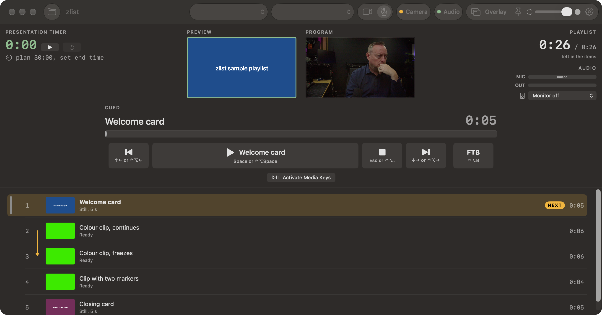
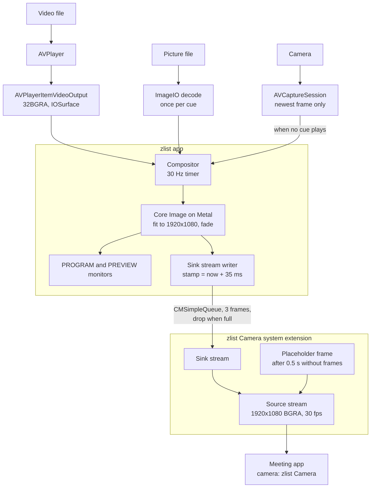
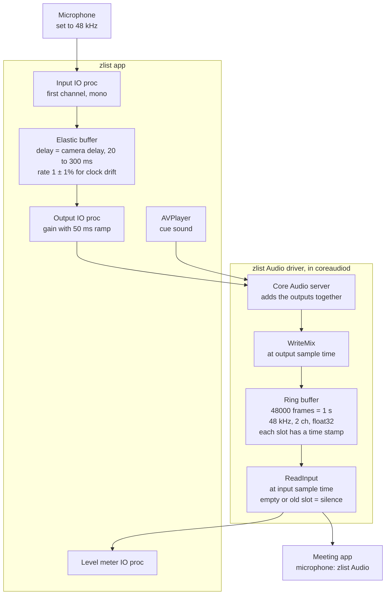
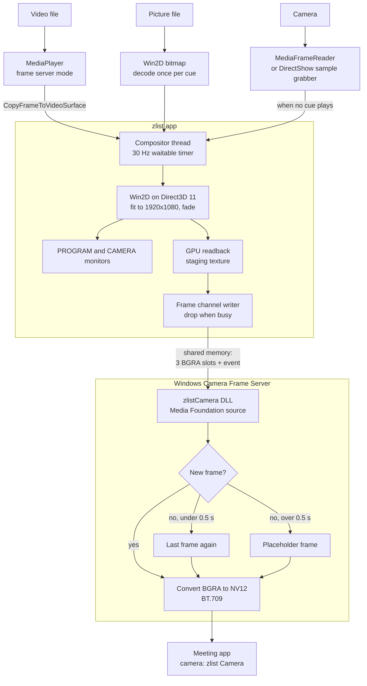
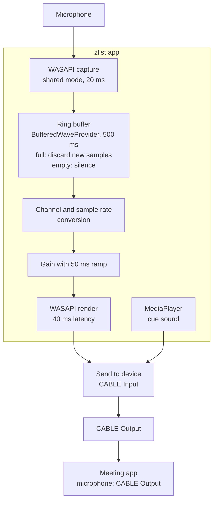

# zlist releases

This repository is the public release channel for
[zlist](https://github.com/kindlyops/zlist). Download zlist from the
[releases page](https://github.com/kindlyops/zlist-releases/releases).

## What zlist does

zlist plays a playlist into a virtual camera and a virtual microphone.
Zoom, and other meeting apps, can select these devices as a camera and a
microphone.

zlist opens these types of playlist:

- A VLC playlist.
- A Mitti project.
- A folder of video files.

Each item in the playlist is a cue. A cue is a video or a still picture.

You can try your own type of playlist. If zlist cannot open it, tell us
in an [issue](https://github.com/kindlyops/zlist-releases/issues). Also
tell us about other video players that you want zlist to support.

When no cue plays, the virtual camera sends the picture from your camera.
The virtual microphone sends the sound from your microphone. When a cue
plays, the virtual camera sends the cue, and the virtual microphone sends
the sound of the cue.

The window has two monitors. PROGRAM shows what the virtual camera sends.
PREVIEW shows what goes to the meeting next. The meeting does not see the
monitors, the clocks, or the cue list.

You can control zlist in these ways:

- With the buttons in the window: Previous, Play, Stop, Next, and FTB
  (fade to black).
- With hotkeys that work from all apps.
- With the media keys on the keyboard.
- With OSC messages on UDP port 9000, for example from Bitfocus Companion.

The presentation timer measures the time of the full talk. The playlist
clock shows the time that is left in the cues.

Overlay mode makes the window smaller. A strip with the controls stays at
the top of the screen, and the cue list stays at the right edge. Then the
meeting app can use the other parts of the screen.

zlist has a sample playlist with title cards and color clips. To open it,
click **Open Sample Playlist** in the empty cue list.

The sample playlist also has a **Sync test** cue. Once each second, the
picture flashes white and a beep starts. Play it in a test meeting. Make
sure that you see each flash and hear each beep at the same time.

## Install zlist on a Mac

zlist operates on macOS 14 or later, on Apple silicon and Intel Macs.

1. Download `zlist-<version>.zip` from the releases page.
2. Open the zip file.
3. Move `zlist.app` to the `Applications` folder. The virtual camera
   operates only from this folder.
4. Open zlist.
5. When macOS asks for access to the camera and the microphone, click
   **Allow**.
6. Click the **Camera** button in the toolbar of zlist.
7. In System Settings, go to General > Login Items & Extensions > Camera
   Extensions.
8. Turn on "zlist Camera".
9. In zlist, go to Settings > Audio.
10. Click **Install** to install the virtual microphone.
11. When macOS asks for your password, type it. The sound of the Mac stops
    for approximately one second.
12. In Zoom, select **zlist Camera** as the camera.
13. In Zoom, select **zlist Audio** as the microphone.

zlist gets updates from this repository. To get an update, click
zlist > Check for Updates.

## Install zlist on Windows

zlist operates on Windows 11. The Windows release does not have a signature
yet. Thus, Windows installs it only when Developer Mode is on.

1. Install VB-CABLE from <https://vb-audio.com/Cable/>. Zoom records the
   sound of zlist from this cable.
2. In Windows Settings, go to System > For developers.
3. Turn on **Developer Mode**.
4. Download `zlist-<version>-windows-x64.zip` from the releases page.
   If your computer has an ARM processor, download
   `zlist-<version>-windows-arm64.zip`.
5. Extract all the files from the zip file.
6. Open PowerShell in the extracted folder.
7. Type `powershell -ExecutionPolicy Bypass -File .\install.ps1`, then
   press Enter.
8. Open zlist from the Start menu.
9. When Windows asks for access to the camera and the microphone, click
   **Yes**.
10. Click the **Camera** button in the toolbar of zlist.
11. Click **Install**.
12. When Windows asks for administrator permission, click **Yes**.
13. In zlist, go to Settings > Audio > Send to.
14. Select **CABLE Input (VB-Audio Virtual Cable)**.
15. In Zoom, select **zlist Camera** as the camera.
16. In Zoom, select **CABLE Output (VB-Audio Virtual Cable)** as the
    microphone.

The Windows release does not get updates automatically. To install a new
release, do steps 4 to 8 again with the new zip file.

## Make sure that a download is correct

Each release has a `SHA256SUMS` file. This file has a SHA-256 checksum for
each file of the release.

1. Download `SHA256SUMS` into the folder that has your download.
2. On a Mac, type this command in Terminal, in that folder:
   `shasum -a 256 -c SHA256SUMS --ignore-missing`
3. Make sure that the output shows `OK` for your file.

## Contents of this repository

- Each release has `zlist-<version>.zip` (the Mac app), the Sparkle
  `.delta` updates, the Windows zip files, and `SHA256SUMS`. The Mac app
  has a Developer ID signature, and Apple notarized it.
- The `gh-pages` branch has the Sparkle appcast at
  `https://kindlyops.github.io/zlist-releases/appcast.xml`. The Mac app
  reads this appcast to find updates.

## How zlist plays video and sound

This section is for technical readers. It shows how zlist moves pictures
and sound from a cue to the meeting app on each platform.

### Common rules

- The virtual camera always sends 1920x1080 frames at 30 frames per
  second. zlist fits each picture into that frame and fills the remainder
  with black.
- A compositor draws one output frame on each tick of a fixed 30 Hz clock.
  It draws the playing cue. When no cue plays, it draws the camera. If the
  source has no new frame, the compositor sends the last frame again.
- Fade to black (FTB) changes the picture to black in 0.5 seconds. In the
  same 0.5 seconds, the sound of the cue fades out. FTB also closes the
  microphone relay.
- The microphone relay is open only when no cue with sound plays and the
  microphone is not muted. The gain changes in 50 ms, so you do not hear
  a click.
- Each platform plays the sound of a cue directly to the output device.
  zlist does not mix the sound in the app.
- When zlist is not open, the virtual camera sends a dark gray
  placeholder frame. It does this also when no frame arrives for 0.5
  seconds.

### macOS video

`AVPlayer` decodes the video file. The compositor reads the frame for the
current host time from `AVPlayerItemVideoOutput`. Core Image on Metal
scales the frame and applies the fade. The output buffers are IOSurface
pixel buffers, so the preview monitors show them without a copy. A
CoreMediaIO sink stream sends each frame to the zlist Camera system
extension. The extension sends the frame to the meeting app on its source
stream.

A frame needs more time than the sound to get to the meeting app. Thus
the compositor draws each frame 35 ms before its time. It stamps the
frame with that time, and the extension keeps the stamp. The compositor
takes the video frame that is nearest to that time.

### macOS sound

zlist Audio is a Core Audio driver (an AudioServerPlugIn). It has one
output and one input. A ring buffer in the driver connects them. The
ring buffer holds 1 second of 48 kHz stereo 32-bit float samples. Each slot
holds a sample time stamp. The output side writes at the output sample
time, and the input side reads at the input sample time. If a slot is
empty or old, the input side reads silence. Thus an underrun or an overrun
gives silence, not old sound.

`AVPlayer` plays the sound of a cue directly to the zlist Audio output.
The microphone relay uses raw Core Audio IO procs. Its input IO proc
writes the first channel of the microphone into an elastic buffer in the
app. The output IO proc reads that buffer, applies the gain, and writes
to the zlist Audio output. The Core Audio server adds the two outputs
together before the driver writes them into its ring buffer.

The elastic buffer keeps the voice for a set delay. The microphone and
zlist Audio have different clocks, so the buffer reads up to 1% faster
or slower to keep the delay constant. It does not remove or repeat
samples. While the camera is on air, the delay is the time that the
camera picture needs to go out, between 20 and 300 ms. Thus the voice and
the lips go out together.

### Windows video

`MediaPlayer` from Windows.Media.Playback decodes the video file in frame
server mode. The compositor copies the current frame into a Win2D render
target on Direct3D 11. The compositor runs on its own thread with a
high-resolution waitable timer. It fits the frame into 1920x1080 and draws
the fade as a black layer. A GPU readback copies the frame to a staging
texture. Then the app writes the frame into shared memory.

The virtual camera is a Media Foundation media source in a DLL. The app
registers it with `MFCreateVirtualCamera`. The Windows Camera Frame Server
loads the DLL and sends its frames to the meeting app. The shared memory
has three frame slots, so the writer and the reader never use the same
slot. An event tells the DLL that a new frame is ready. The DLL sends a
frame each 33.3 ms. It sends a new frame when one is available. Otherwise
it sends the last frame again for a maximum of 0.5 seconds, and then the
placeholder.

### Windows sound

Windows has no supported way for an app to add a virtual microphone.
Thus zlist sends its sound to a loopback cable, for example VB-CABLE. The
meeting app records from the other end of the cable.

The same `MediaPlayer` that decodes the video also plays its sound. Its
audio device is the **Send to** device. The microphone relay uses NAudio
with WASAPI in shared mode. A capture client with a 20 ms buffer writes
into a ring buffer (NAudio `BufferedWaveProvider`, which uses a circular
buffer) that holds 500 ms. When the ring buffer is full, new samples are
discarded. When it is empty, the relay plays silence. Next, the relay
changes the channel count and the sample rate to the format of the Send
to device. Then it applies the gain and plays to the cable with 40 ms of
latency. The Windows audio engine adds the two streams together before
they go into the cable.

### Timing

The media player keeps the sound and the picture of a cue together. On
macOS, `sync-probe` in the zlist repository measures the result: it
plays a clip with a flash and a beep, and records zlist Camera and zlist
Audio in the same way as a meeting app. In three tests, the sound arrived
between 17 ms before and 22 ms after the picture. Before the 35 ms lead,
the sound arrived 55 to 64 ms before the picture.

- On macOS, the remaining difference comes from the 30 Hz compositor
  clock. It changes each time zlist starts, by a maximum of half a frame
  (17 ms).
- On Windows, the timing is not measured yet. The picture can be one or
  two frames (33 to 67 ms) late, and the microphone relay adds
  approximately 60 to 500 ms.
